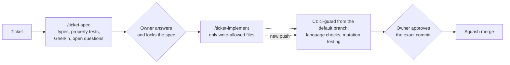

# agent-guardrails

[](https://github.com/senoldogann/agent-guardrails/actions/workflows/ci.yml)
[](https://github.com/senoldogann/agent-guardrails/releases)
[](LICENSE)

Spec-first guardrails for [Claude Code](https://claude.com/claude-code) on GitHub. A human writes the contract
for a ticket (types, property tests, acceptance scenarios) before any code exists. The agent implements only
inside that locked spec. Deterministic checks decide when the work is done, and nothing merges until the
human approves the exact commit.

**Why.** A coding agent that grades its own work will sometimes weaken a test, skip a check or declare a task
done that is not. Reviewing every line afterwards does not scale. This kit moves the human's effort to the
front (deciding what "correct" means) and lets machines enforce it: locked tests, a guard that runs from the
default branch so a PR cannot change the rules that judge it, mutation testing to show the tests have teeth,
and a per-commit approval that a new push invalidates.

**Status:** 0.x, used daily by its author on macOS. Expect changes between minor versions; see
[CHANGELOG.md](CHANGELOG.md).

## How it works



- **Spec phase:** the agent writes branded contract types with stubs, property tests and acceptance tests named
  after the acceptance criteria, plus open questions, each with a recommended answer. It writes no
  implementation. The owner answers the questions; the spec and the test IDs are then locked by hash.
- **Implement phase:** a local write-guard lets the agent change only the files listed in the ticket's
  `write-allow`, and a stop hook keeps it working until `make check` passes.
- **CI:** `ci-guard` runs from the default branch through `pull_request_target` and reads the PR only as data.
  It fails a PR that changes locked spec files or tests without a new lock, carries a lock that leaves out a
  locked file or is not what `spec-lock` writes, removes a lock, adds a workflow that could stand in for a
  required check, or carries merge commits, symlinks and similar. A new lock that stops locking a file passes
  as an amendment, and the guard lists each such file for the owner. Changes to the guardrails
  themselves (`.agent/`, the Makefile, workflows) are listed for the owner, who confirms them separately when
  approving; they do not fail the guard, because kit updates change them. Language checks run the type
  checker, linter, tests and a mutation gate on the changed code.
- **Security:** the `security` check scans every PR with free, open-source scanners and fails it on a
  finding: [gitleaks](https://github.com/gitleaks/gitleaks) looks for secrets in the PR's commits,
  [osv-scanner](https://github.com/google/osv-scanner) for known vulnerabilities in the dependency lockfiles,
  and [Semgrep CE](https://github.com/semgrep/semgrep) for insecure code in the changed files (only findings
  new since the base). Each tool is pinned to an exact version and verified by checksum; Semgrep uses the
  security rules of [semgrep-rules](https://github.com/semgrep/semgrep-rules) at a pinned commit, without
  login, registry or token (those rules are under the Semgrep Rules License, fetched in CI, never committed).
  osv-scanner sends package names and versions, not code, to the free OSV API. Inline suppressions
  (`nosemgrep`, `gitleaks:allow`) and the scanners' own ignore files have no effect: only a line in
  `.github/security-ignore` (`<scanner> <id> <path> # <reason>`) accepts a finding, and changing that file
  needs the owner's second confirmation like any guardrail file. An osv line holds while it stays in the
  file; a gitleaks or Semgrep line accepts findings only in the PR that adds it, so a later secret or insecure
  line at the same path needs a new decision. Known gaps: gitleaks skips its default allowlisted paths (images,
  lockfiles such as `go.sum`), and a new advisory in the OSV database can turn unrelated PRs red until the
  dependency is raised or the owner accepts it.
- **Approval:** a ruleset requires the guard, the checks and the owner's approval of the PR's current HEAD. A
  push after the approval needs a new one. The approval shows the files of exactly the base and head it read
  (a PR of 300 or more changed files is refused, since GitHub lists no more) and stops if the PR moves before
  it writes.

Supported languages: TypeScript and JavaScript (Vitest, fast-check, Stryker), Python (pytest, Hypothesis,
mutmut), Rust (proptest, cargo-mutants) and Swift packages (swift-testing; no mutation gate).

## Requirements

- macOS or Linux with `git`, `jq`, `curl`, `openssl` and the GitHub CLI `gh`, signed in (`gh auth login`).
- [Claude Code](https://claude.com/claude-code), which runs the skills and hooks. Cursor's agent and the Codex
  CLI are guarded too, with fewer checks (see [Supported agents](#supported-agents)).
- A writable directory on `PATH`: `~/.local/bin`, `/opt/homebrew/bin` or `/usr/local/bin`.
- `python3` for registering the agent's GitHub App (`guardrails agent create`).
- For the menu bar app: macOS 26 and Xcode 26 or newer.
- Repository rulesets on private repositories need GitHub Pro, Team or Enterprise.

## Install

Install from a clone you don't develop in. The owner commands compare projects against this checkout and
refuse to run when it has local changes.

```sh
git clone https://github.com/senoldogann/agent-guardrails ~/.local/share/agent-guardrails
~/.local/share/agent-guardrails/install.sh
make -C ~/.local/share/agent-guardrails app   # optional, macOS: installs ~/Applications/Guardrails.app
```

`install.sh` checks everything first, then links the skills into `~/.claude/skills`, registers the global hooks
in `~/.claude/settings.json` (after backing it up) and links the owner command onto `PATH` as both `guardrails`
and `agent-guardrails` (other tools also install a `guardrails` command; use the longer name if one does).
Where Cursor or Codex is set up (`~/.cursor` or `~/.codex` exists), it also adds the kit's hooks to
`~/.cursor/hooks.json` or `~/.codex/hooks.json`, after backing the file up and keeping your other hooks. If you
start using one of them later, run `install.sh` again.

To update, press **Update** in the menu bar app when it offers one, or run `guardrails update`. It shows the
new commits, asks you to confirm the exact one, fast-forwards the clone, runs `install.sh` again and rebuilds
the app. `guardrails version` shows what is installed.

## Daily use

1. In a project, ask Claude for `/guardrails-init`. It opens a bootstrap PR with the kit's files, the project's
   `Makefile` and `AGENTS.md`. In the app: **Set up…** on the repository's page.
2. Read that PR, then turn the project on: **Turn on** in the app, or `guardrails on <PR URL>`.
3. Work ticket by ticket: `/ticket-spec <ID>`, answer the open questions, lock the spec, `/ticket-implement <ID>`.
4. When CI is green, approve: **Review** in the app (Touch ID), or `guardrails approve <PR URL>` (typed
   confirmation of the commit).

`guardrails` without arguments, or the menu bar app, lists what waits for you: questions from the agent, PRs
to approve, bootstrap PRs to turn on, and alarms. The app also sends a notification for each new one. Its
one window works like an editor: the sidebar lists the overview, your repositories and settings, and pull
requests and reviews open in tabs (⌘W closes one, ⌃Tab moves between them, ⌘R refreshes, ⌘F searches).
Before you approve, the Review tab shows the PR's checks on that exact commit, the steps and mutation verdict
of the kit gate from its CI log, and the spec the PR carries. A pull request's tab shows its description,
checks, comments, history and diff, with the actions around it (comment, request changes, merge an approved
PR, auto-merge, draft or ready, close or reopen). Approving still goes through Review. Settings (⌘,) and a
first-launch checklist cover the rest of the set-up on your Mac.

`guardrails report [owner/repo] [--days N] [--json]`, or **Reports** in the app's sidebar, shows how agent work
went over the last N days (default 30; the app offers 7, 30 and 90) in every enforced repository: pull requests
merged by the agent App and by people, the median and 90th percentile time from ready for review to approval and
to merge, PRs that needed a new approval after a push, PRs with a failing guard or checks run and how many merged
after a later green run, merges without an approval on their final commit (an admin bypass, or a merge before the
guardrails were on), and every ruleset change with its time, author and what changed. It only reads GitHub.

## The agent's own GitHub identity

By default the agent works with your GitHub login. GitHub does not let you approve your own pull requests, so
the kit records your approval as the commit status `merge-approval` (**status mode**). With an agent App the
agent pushes and opens PRs as the App's bot, and you approve them with an ordinary GitHub review, also from
github.com or GitHub Mobile (**review mode**):

1. **Create…** under Agent identity in the app's sidebar, or `guardrails agent create`, registers a
   private GitHub App in your browser. It may write contents and pull requests only: no workflows,
   administration or statuses.
2. Install it with **Only select repositories** on the projects the agent works in (**Manage** in the app).
3. Each project needs `.github/CODEOWNERS` whose first line is `* @<you>` (new bootstrap PRs add it).
4. **Switch to review mode** on the project in the app, or `guardrails on <owner/repo>`. A code owner's review
   is then required, and GitHub dismisses it when a push changes the PR. **Review** on your own PR merges it
   with your admin bypass, which skips the review but never the checks.

## Merge queue (teams)

Each PR's checks run on that PR alone. When several people or agents merge into the same branch, two PRs that
each pass can still break the default branch together. GitHub's merge queue squashes approved PRs onto the
default branch in order and runs the required checks on that combined commit before anything merges.

Use it for a team repository with several PRs in flight at once. It needs:

- a repository an organization owns: GitHub offers merge queues for public organization repositories, and
  for private ones only on GitHub Enterprise Cloud. Personal repositories cannot have one, and keep working
  as before without it;
- review mode (the agent App installed): in status mode your approval is a commit status on the PR's head,
  which the queue's combined commit never carries.

Turn it on with **Turn on merge queue** on the project's page in the app, or
`guardrails on <owner/repo> --merge-queue`; `--merge-queue` also works with a bootstrap PR link. The ruleset
then requires the queue for everyone: squash merges, each PR in a group must pass every check (not just the
last one), at most 3 PRs per group and 3 groups checked at once, and a check that reports nothing in 60
minutes counts as failed. A later plain `guardrails on` keeps the queue (and restores it if it went missing);
`guardrails on <owner/repo> --no-merge-queue` removes it. The inbox raises an alarm when a repository you
turned it on for loses it.

With the queue, **Merge** in the app (and `gh pr merge`) adds an approved PR to the queue instead of merging
it, and **Review** on your own PR adds it to the queue at the confirmed commit. Whether GitHub lets your admin
bypass skip the code owner review for a queued PR is not verified yet; if it refuses, `guardrails approve` says
why and nothing merges, and a teammate who is a code owner can approve it. On a group commit `guard` runs the
default branch's `ci-guard-group` (never the group's own copy), the language checks run the full gate
(`make check`; the spec and mutation gates ran on the PR), and `security` scans the group's changes.

A project set up before the kit had the queue takes the update in two PRs: first every kit file except
`.github/workflows/agent-guard.yml` (its guard on the default branch does not yet accept the new trigger), then
`agent-guard.yml` alone.

## Team notifications (Slack, Microsoft Teams)

The menu bar app tells you; a team channel can hear about the same events for every enforced repository. Each
project carries the workflow `.github/workflows/agent-notify.yml`, which stays off until you add a webhook
secret. It posts one short line per event, with a link to the PR:

> acme/shop #12 · feat: add cart — waits for your approval

The events are: a PR waits for approval (guard passed, or the agent's question was answered and its label
removed), is blocked (guard failed), the agent asks for a decision (label `needs-decision`), a PR was approved
(status mode) or merged. A guard pass is announced only when no guard run on that commit failed. Approving still happens in your
own tools; the message only informs, and no ruleset requires the workflow, so it never blocks a merge.

**Slack:**

1. At [api.slack.com/apps](https://api.slack.com/apps), **Create New App** → **From scratch**, in your
   workspace.
2. **Incoming Webhooks** → turn on **Activate Incoming Webhooks** → **Add New Webhook to Workspace**, pick the
   channel, **Allow**, and copy the webhook URL.
3. Add it as the secret `GUARDRAILS_SLACK_WEBHOOK`.

**Microsoft Teams** (Office 365 connector webhooks are retired; Teams uses Workflows):

1. In the channel, **More options (…)** → **Workflows** → the template **Send webhook alerts to a channel**,
   set the team and channel, **Save**, and copy the webhook URL.
2. Add it as the secret `GUARDRAILS_TEAMS_WEBHOOK`.
3. The workflow belongs to the person who created it; add a co-owner in the Workflows app so it outlives a
   departure.

**The secret:** for one repository, its **Settings** → **Secrets and variables** → **Actions** → **New
repository secret**, or `gh secret set GUARDRAILS_SLACK_WEBHOOK -R <owner/repo>` (it asks for the value). For
several repositories, add an organization secret with access for the enforced repositories. Set one secret or
both. Without either, the workflow does nothing and succeeds.

**Limits:**

- In review mode an approval is a GitHub review, and no review event runs a workflow from the default branch,
  so the channel hears about an approved PR when it merges.
- Each guard result is posted once per commit: the guard runs again when a PR's title or description changes,
  and the repeat is not posted. Drafts are not announced until they are ready for review.
- PRs from forks are not supported (as for the guard).
- Every event starts a short job; in private repositories it counts toward your GitHub Actions minutes.

**Security:** the workflow holds the webhook URL and reads PR titles the agent wrote. It runs only on events
that take the workflow from the base branch (`pull_request_target`, `workflow_run` of agent-guard, `status`),
checks out only the default branch's `.agent/bin`, never PR code, and has read-only permissions. The payloads
are built with `jq`: titles lose control and invisible formatting characters, Slack shows them as literal rich
text (no mentions such as `<!channel>`, no links), and the only link is the PR, built from the repository and
the PR number. curl reads the URL from its standard input, so it never appears in arguments or the log. The
workflow and `.agent/bin/notify-team` are kit files: `guardrails on` refuses a project whose copies differ
from your installed kit, and `guardrails approve` marks a change to them `!!`. Anyone who can push a workflow
to the repository can read its secrets; the agent App cannot change workflows, but in status mode the agent
works with your login. A leaked webhook can only post to its one channel: give it a channel of its own, and
replace the webhook if it leaks.

## What it changes on GitHub

`guardrails on` sets, for that repository: the `agent-guardrails` ruleset on the default branch (no deletion,
no force push, linear history, squash-merged PRs with resolved threads, the required checks `guard`,
`security` and `checks-<lang>`, in status mode `merge-approval`, and with `--merge-queue` the merge queue); in review mode the `agent-guardrails-review` ruleset (one code owner review, dismissed
on push, last push approved by someone else, admins may bypass it through a PR); the `agent-guardrails-tags`
ruleset (only admins create, move or delete tags); squash merge only with auto-merge and branch deletion;
read-only workflow tokens that cannot approve PRs; SHA-pinned actions; the label `needs-decision`; and the
topic `agent-guardrails`. `guardrails off <owner/repo>` deletes the three rulesets, removes the topic and
merges a PR that removes the kit's files; the repository settings stay.

## Supported agents

The same rules guard every agent: `hooks-global/bash-guard.sh` decides which commands are blocked, and the other
agents' hooks only translate their protocol to it. What each agent enforces locally:

| | Claude Code | Cursor agent | Codex CLI |
| --- | --- | --- | --- |
| Shell commands checked by bash-guard | yes | yes (`beforeShellExecution`) | yes (`PreToolUse` `Bash`), once trusted |
| Files read with the agent's read tool checked for credentials | no | yes (`beforeReadFile`) | no |
| Reminder on every prompt | yes | no | yes |
| gh and git push as the agent App | yes | no, your gh login | no, your gh login |
| Hooks committed with the project | bash-guard, write-guard, stop-check | bash-guard (through `cursor-guard.sh`) | none |

- **Cursor** ([hooks](https://cursor.com/docs/agent/hooks)): `hooks-global/cursor-guard.sh` hands
  `beforeShellExecution` and `beforeReadFile` to bash-guard and answers with Cursor's JSON. A read is checked by
  its path against bash-guard's rules on credential files and your own kit files, in every workspace root, so a
  kit repository opened next to another folder is covered. The hooks are registered with `failClosed`, so a
  crash or timeout blocks the action. `/guardrails-init` also commits `.cursor/hooks.json`, which runs
  `.agent/hooks/cursor-guard.sh` in every teammate's Cursor; Cursor runs project hooks only in a trusted
  workspace. A teammate whose installed kit predates Cursor support has every shell command denied there until
  the kit is updated. Cursor also imports Claude Code hooks from `.claude/settings.json` and `~/.claude/settings.json`
  (Settings, Agents, Third-Party Imports; on by default), but does not document how it translates their input,
  so the kit does not rely on that. The kit's tests feed the documented hook input to the adapter; they do not
  run Cursor itself.
- **Codex** ([hooks](https://developers.openai.com/codex/hooks)): Codex sends the same hook input as Claude Code,
  so `~/.codex/hooks.json` runs `bash-guard.sh` and `prompt-reminder.sh` unchanged. Codex skips new or changed
  hooks until you trust them: after `install.sh`, open `/hooks` in Codex and trust both. Codex lets a tool
  call run when a hook times out or cannot start (bash-guard turns its own errors into a block), and does not
  run the hook again when the agent writes to a command that is already running. The kit commits no
  `.codex/hooks.json` to projects, because Codex runs project hooks only in trusted projects and only after each
  user has trusted each hook.
- **Not in Cursor or Codex:** write-guard and stop-check, which use Claude Code's hook protocol. Nothing stops
  these agents from editing files outside `write-allow` as they work, or from finishing before `make check`
  passes. In the PR, `ci-guard` still fails changed locked specs and tests and lists every human-owned path it
  changes, and the language checks still have to pass.
- **Agent identity:** `agent-identity.sh` hands the App's token to Claude Code's shell commands through
  `CLAUDE_ENV_FILE`. Cursor's `sessionStart` hook passes environment variables only to later hooks, not to the
  agent's commands, and Codex has no hook that sets them, so Cursor and Codex run gh and git push with your own
  gh login. In review mode their PRs are then yours: you merge them with **Review** or `guardrails approve`
  through your admin bypass, and the protection rests on the rulesets and `ci-guard` on GitHub. The limits of
  status mode below apply to them, whatever the repository's mode.

## Security model and limits

- **The boundary is on GitHub.** Rulesets and `ci-guard` (which runs from the default branch, so a PR cannot
  change the guard that judges it) decide what merges. Local hooks and the app make the right path easy; they
  are not a boundary.
- **Status mode does not stop a hostile agent.** The agent runs with your login, which can change rulesets.
  `bash-guard` blocks owner-only commands, credential reads and settings changes by matching command text,
  which a deliberately disguised command can evade. It stops mistakes and shortcuts, not an adversary.
  **Teams use review mode:** register the agent App (`guardrails agent create`), install it on the
  repositories, and run `guardrails on <repo>` again. Status mode is for one owner who accepts these limits.
- **The agent's identity is checked per session** (Claude Code only). In a kit repository with the agent App
  registered, gh and `git push` are blocked unless the session's identity was set up for that repository at its
  start; a session started elsewhere would otherwise reach GitHub with your login.
- **Review mode separates identities,** and the App cannot change workflows. While the agent runs as your
  computer user it can still reach your own login, so for a hard boundary run the agent as another user, in a
  container or in CI with only the App's token.
- Other administrators of a repository can change or remove its rulesets. The inbox raises an alarm when the
  list of enforced repositories stops matching, or when the live rulesets stop protecting what the kit set up:
  a ruleset missing or inactive, a bypass list added, a rule removed, guard, security or the language checks
  no longer required from GitHub Actions, no rule left that requires your approval, or a merge queue you turned
  on gone or weakened. A project set up before
  the kit had the security check shows that alarm until a kit update PR adds `security.yml` and you run
  `guardrails on <owner/repo>` again.
- **The security check runs the PR's own copy** (`pull_request`, like the language checks), so a PR could
  weaken it; every file that can (the workflow, `.agent/`, `.github/security-ignore`) is a guardrail file that
  `approve-head` marks `!!`, and `guard` lists accepted findings for you.

Report vulnerabilities as described in [SECURITY.md](SECURITY.md).

## Uninstall

Turn each project off first (`guardrails off <owner/repo>`). Then remove the links `guardrails`,
`agent-guardrails`, `approve-head` and `revoke-head` from your `PATH` directory, the skill links in
`~/.claude/skills` that point into the kit, the hooks in `~/.claude/settings.json` whose command points into
the kit (`bash-guard.sh`, `prompt-reminder.sh`, `agent-identity.sh`), the hooks in `~/.cursor/hooks.json` and
`~/.codex/hooks.json` that point into the kit, `~/Applications/Guardrails.app`,
`~/.config/agent-guardrails` and the kit clone.

## Glossary

- **Owner:** the human who decides and approves; the only one who runs the `guardrails` state-changing
  commands.
- **Kit:** this repository's files that `/guardrails-init` copies into a project (`.agent/`, hooks, workflows).
- **Bootstrap PR:** the PR that adds the kit to a project; turning the project on merges it.
- **Locked spec:** the ticket's contracts, tests and test IDs, fixed by hash once the owner has answered the
  open questions.
- **HEAD:** the PR's latest commit. Approvals are for one exact HEAD.

## Contributing

See [CONTRIBUTING.md](CONTRIBUTING.md). The repository layout and commands are in [AGENTS.md](AGENTS.md).

## License

[MIT](LICENSE)
